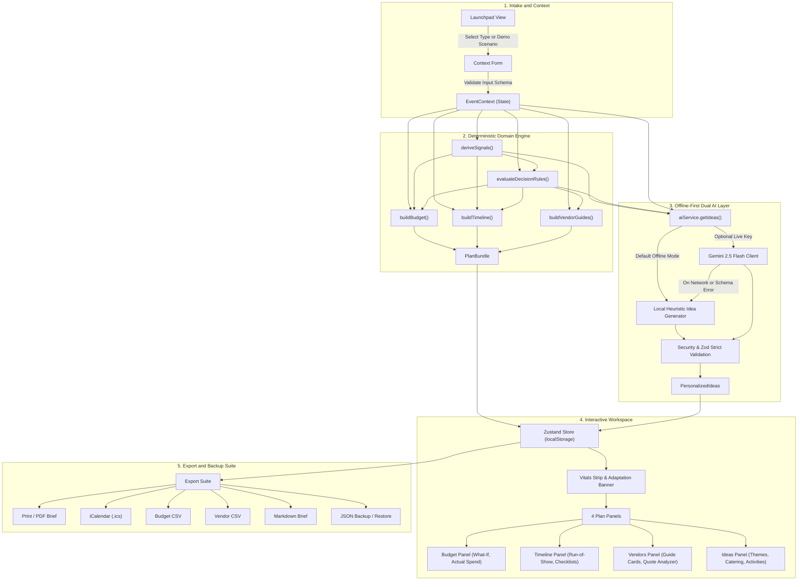

# Gather: Celebration & Event Planner

Gather is an offline-first, client-only Single Page Application built to coordinate cross-cultural weddings, milestone birthdays, and community events with deterministic financial allocations, backward-scheduled timelines, vendor evaluation checklists, and personalized ideas. Operating entirely inside the user's web browser, Gather couples pure TypeScript calculation engines with an offline-first dual-engine design that requires zero third-party accounts, remote databases, or API keys to function out of the box, while offering an optional live Google Gemini adapter for contextual idea generation.

### Quick Start

1. Install project dependencies:
   ```bash
   npm install
   ```
2. Start the local development server:
   ```bash
   npm run dev
   ```
3. Run the automated test suite:
   ```bash
   npm test
   ```
4. Build the production application bundle:
   ```bash
   npm run build
   ```

Gather requires zero API keys, login credentials, or external network connections to run out of the box. All calculations, budget splits, milestone timelines, vendor evaluation guides, run-of-show schedules, and curated ideas execute 100% offline using deterministic domain logic and local seed libraries. Live AI ideation using Google Gemini 2.5 Flash is strictly optional and can be enabled by entering an API key in the application interface, stored transiently in `sessionStorage` with zero persistence.

## 1. Chosen Vertical and Persona

### Flagship Vertical: Cross-Cultural and Multi-Day Wedding Coordination

The flagship vertical addressed by Gather is the coordinator of cross-cultural, interfaith, and multi-day weddings. Families planning celebrations in this category face logistical challenges that conventional single-day wedding tools cannot handle:
- Multi-day ceremonial sequencing spanning distinct events (such as Haldi, Mehndi, Sangeet, Main Ceremony, and Reception) with separate staging, attire, and vendor timelines.
- Strict cultural and dietary requirements (including Jain, pure vegetarian, Halal, Kosher, and vegan diets) requiring dedicated catering isolation and separate vendor compliance contracts.
- Intergenerational guest accommodations, accounting for elderly mobility needs (step-free access, shaded seating, low-decibel breakout spaces) and multi-age schedules.
- Seasonal weather vulnerabilities, specifically outdoor monsoon rains or extreme summer heat in regional climates, requiring reserve buffers and contingency shelters.
- Multi-currency budgeting, natively supporting Indian Rupee (INR) formatting alongside USD, EUR, and GBP with localized integer arithmetic.

### Shared Domain Engine Across Event Types

Gather uses the same core domain engine for all three celebration types:
1. **Weddings**: Addresses multi-day sequencing, ceremonial stage turnarounds, specialized cultural catering, attire changes, and venue contracts.
2. **Birthdays**: Focuses on age-tailored entertainment rotations (toddlers aged 1-3, school kids aged 4-12, teens, and adult milestones), surprise party reveal coordination, and strict allergy alerts (such as peanut or latex allergies).
3. **Community Events**: Handles large crowd logistics, municipal liaison permits, volunteer marshalling schedules, sponsor deliverables, and public safety egress.

Each event type supplies its own dedicated category sets, baseline planning heuristic splits, per-guest budget floors, and task templates into the pure domain engines, ensuring consistent architectural guarantees across all celebrations.

### Mission Brief Alignment

Gather directly aligns with the celebration planner mission brief:
- **Budgeting**: Enforces integer-currency allocations where category sums plus contingency strictly equal the total budget, preventing penny-rounding discrepancies.
- **Scheduling**: Employs backwards scheduling from the event date, topological dependency ordering, and automated compression under short-notice constraints.
- **Vendor Management**: Delivers vetted interview questions and safety verification criteria without fabricating real-world business names, ratings, or prices.
- **Ideation**: Provides instant, offline-first contextual themes, catering pairings, activities, and custom tasks matched to event signals, with optional live LLM enhancement.

## 2. Approach and Logic

### Hybrid Deterministic and Dual-Engine AI Architecture

Gather separates critical planning mathematics from creative ideation:
- **Pure TypeScript Domain Layer (`src/domain/`)**: Pure functions executing without DOM, browser storage, or system clock side-effects. Engines accept `today` as an explicit ISO string parameter (`YYYY-MM-DD`), making all calculations completely reproducible and testable.
- **Offline-First AI Layer (`src/ai/`)**: An offline-first dual-engine design where a local deterministic generator (`src/ai/localIdeaGenerator.ts`) scores and selects ideas from curated banks. When an optional Gemini API key is provided, the live adapter (`src/ai/geminiClient.ts`) requests structured JSON completions, automatically falling back to the local engine on any network, schema, or rate-limit failure.

### Context Signals and Rule Adaptations

Event parameters are derived into signals via `deriveSignals()` in `src/domain/signals.ts`, which are evaluated by 18 deterministic rules defined in `src/data/decisionRulesCore.ts` and `src/data/decisionRulesContext.ts`:

| Rule ID | Module | Severity | Trigger Condition | Adaptation Applied | Contingency Delta |
| :--- | :--- | :--- | :--- | :--- | :--- |
| `PAST_DATE` | Timeline | Critical | Event date is in the past (`daysUntilEvent < 0`) | Locks schedule milestones as overdue without modifying scheduled dates. | +0% |
| `SHORT_NOTICE` | Timeline | Warning | Planning runway under 21 days (`daysUntilEvent < 21`) | Compresses timeline into fast-track booking milestones; marks optional tasks as skipped; adds reserve buffer. | +2% |
| `TIGHT_PER_HEAD` | Budget | Critical / Warning | Per-guest spend below heuristic floor (`perGuestBudget < floorPerGuest`) | Rebalances budget to protect core hospitality categories; flags constructive cost-saving swaps. | +0% |
| `MICRO_EVENT` | Budget | Info | Intimate guest count (`guestCount < 50`) | Applies `MICRO_EVENT_FIXED_COST_MULTIPLIER` (1.15) to absorb fixed overheads. | +0% |
| `LARGE_CROWD` | Safety | Warning | Guest count >= 1000 | Injects crowd management checklists, emergency egress protocols, and reserve buffer. | +2% |
| `YOUNG_KIDS` | Safety | Warning | Subformat is `kids_1_3` | Introduces toddler childproofing checkpoints, quiet rest zones, and safety milestones. | +0% |
| `SCHOOL_KIDS` | Safety | Info | Subformat is `kids_4_12` | Schedules structured activity rotations and adult supervision checkpoints. | +0% |
| `OUTDOOR` | Safety | Warning | Venue setting is `outdoor` or `hybrid` | Activates backup weather shelter provisions, rain contingencies, and reserve buffer. | +3% |
| `HOT_OR_WET_SEASON` | Safety | Warning | Outdoor/hybrid venue in `summer` or `monsoon` | Schedules hydration stations, heat mitigation, and rapid weather shelter protocols. | +0% |
| `ALLERGY_ALERT` | Safety | Warning | Flag `nut_allergy`, `latex_allergy`, or `gluten_free` | Mandates dedicated catering preparation zones, allergen ingredient labeling, and cross-contact verifications. | +0% |
| `DIETARY_CULTURAL` | Vendor | Info | Flag `vegan`, `vegetarian`, `jain`, or `halal` | Adapts vendor evaluation guides to mandate certified dietary preparation procedures and separate cookware audits. | +0% |
| `ACCESSIBILITY` | Safety | Info | Flag `wheelchair_access`, `elderly_guests`, or `sensory_friendly` | Adds step-free path audits, accessible restroom inspections, priority seating, and sensory retreat zones. | +0% |
| `MULTI_CEREMONY` | Timeline | Info | `indian_multiday` format or `multi_ceremony` flag | Expands schedule into segmented ceremonial sub-runs and stage turnaround buffers. | +0% |
| `SURPRISE_PARTY` | Timeline | Info | Subformat is `surprise` | Synchronizes guest arrival milestones 30 minutes prior to reveal and schedules diversion logistics. | +0% |
| `COMMUNITY_PUBLIC_EVENT` | Safety | Info | Event type is `community` | Injects municipal permit liaisons, volunteer marshal briefings, and general public safety protocols. | +0% |
| `SPONSORSHIP` | Budget | Info | Flag `sponsorship_needed` | Introduces sponsor tier tracking, deliverable milestones, and revenue offset calculations into budget framework. | +0% |
| `OPEN_BAR` | Vendor | Info | Flag `open_bar` with `guestCount >= 50` | Injects licensed bartending verifications, liquor liability insurance reviews, and safe transportation provisions. | +0% |
| `AMPLIFIED_MUSIC_RESIDENTIAL` | Timeline | Warning | Flags `amplified_music` and `residential_venue` | Schedules sound curfew cutoffs, neighbor notification milestones, and sound limiter verifications. | +0% |

### Budget Allocation Methodology

1. **Base Contingency**: Baseline heuristic contingency reserves are assigned by event type (`wedding`: 8%, `birthday`: 7%, `community`: 12%).
2. **Dynamic Clamping**: Triggered decision rules add contingency deltas. The final contingency percentage is clamped strictly between `CONTINGENCY_MIN` (0.05) and `CONTINGENCY_MAX` (0.15) from `src/config/constants.ts`.
3. **Integer Math and Largest-Remainder Rounding**: The allocatable budget (`totalBudget - contingencyAmount`) is distributed across category weights using the largest-remainder method in `src/utils/allocate.ts`. Category allocations and contingency strictly sum to the total budget with zero rounding leakage.
4. **Priority Rebalancing**: Up to 3 user-selected priorities receive a `PRIORITY_WEIGHT_MULTIPLIER` (1.25) boost, proportionally adjusting the remaining categories.

### Timeline Scheduling Methodology

1. **Backwards Planning**: Due dates are calculated backwards from `eventDate` using task template day offsets (`daysBefore`).
2. **Short-Notice Runway Scaling**: When available runway is less than the baseline planning horizon, task offsets are scaled proportionally. If `daysUntilEvent < COMPRESSED_THRESHOLD_DAYS` (21), optional tasks are flagged as `skippedInCompression`, allowing users to focus on critical-path milestones.
3. **Topological Dependency Sort**: Tasks are ordered via Kahn's algorithm based on their `dependsOn` declarations, guaranteeing prerequisites precede dependent tasks.
4. **Day-of Run-of-Show**: Generates a synchronized minute-by-minute schedule for the event day with ceremonial buffers and cue checkpoints.

### Vendor Evaluation Methodology

Gather avoids fabricating vendor names, addresses, ratings, or prices:
- **Evaluation Guides**: Supplies curated interview questions, essential licensing checks, and contract watchouts mapped to event categories and contextual rules.
- **Quote Comparison**: Evaluates user-entered vendor quotes by computing all-in totals (base quote + service fees and taxes), comparing figures against category budget allocations, and auditing required safety checks.

## 3. How the Solution Works

### End-to-End User Workflow



1. **Launchpad**: The user selects an event vertical (Wedding, Birthday, Community) or selects one of 4 realistic pre-configured scenarios.
2. **Context Form**: The user customizes event date, guest count, total budget, currency, venue setting, season, priority categories, and constraint flags.
3. **Vitals & Adaptation Banner**: Displays per-guest metrics, planning runway, contingency status, and active rule explanations with severity badges.
4. **Four Core Panels**:
   - **Budget Panel**: Category allocations, actual spend tracking, visual progress bars, feasibility alerts, and What-If financial sliders.
   - **Timeline Panel**: Phased milestone task checklists, short-notice compression notices, and day-of run-of-show schedule.
   - **Vendors Panel**: Category evaluation guides, required safety checklists, and quote comparison calculator.
   - **Ideas Panel**: Bespoke theme concepts with color palettes, catering pairings with dietary safety notes, interactive activities, and custom milestones.
5. **Export & Backup**: One-click generation of print briefs, calendar schedules, spreadsheets, plain text notes, and portable JSON backups.

### AI Operation Modes

- `local`: Default mode. Uses deterministic pseudo-random hashing and context matching to select ideas from offline banks (`src/data/ideaBanks/`). Zero network latency and 100% offline reliability.
- `live`: Activated when the user provides an API key. Calls Google Gemini 2.5 Flash (`gemini-flash-latest`) via `https://generativelanguage.googleapis.com/v1beta` with structured system instructions.
- `fallback`: Instant, graceful degradation to the local generator if a live request fails, times out (after 8000ms), encounters rate limiting, or returns malformed JSON.

### Security Measures Implemented

- **Session-Only Secrets**: API keys are saved strictly in `sessionStorage` under `event-planner:api-key`. Keys are never written to `localStorage`, URL parameters, state backups, or git.
- **Input Sanitization**: User notes are filtered through `sanitizeUserText()`, stripping control characters, normalizing unicode (NFKC), and collapsing whitespace.
- **Prompt Injection Defense**: `detectInjection()` scans user input against known jailbreak, role-override, and instruction-escape signatures. Flagged notes are discarded from prompts before inference.
- **Nonce-Delimited Isolation**: User notes sent to the LLM are enclosed within cryptographically randomized XML tags (`<user_notes_${nonce}>`) generated via `crypto.getRandomValues()`.
- **Strict Schema Enforcement**: All AI responses are validated against Zod schemas configured with `.strict()`, rejecting responses containing injected or unexpected keys.
- **Plain Text Rendering**: AI responses are rendered strictly as text nodes in React, preventing HTML, script, or markdown injection.
- **Content Security Policy (CSP)**: Injected into production builds via a dedicated Vite transform plugin in `vite.config.ts`, restricting script, font, connect, and style sources.
- **CSV Formula Injection Mitigation**: CSV export cells starting with `=`, `+`, `-`, `@`, `\t`, or `\r` are prefixed with a single quote (`'`), preventing spreadsheet formula execution.
- **JSON Prototype Pollution Protection**: JSON backups are validated with Zod envelope schemas and size bounds (1 MB limit, bounded array lengths) before state restoration.

### Accessibility and Design System

- **WCAG 2.1 AA Compliance Target**: Visual tokens defined in `src/index.css` are verified through automated test suites (`tests/contrast.test.ts`), maintaining contrast ratios exceeding 4.5:1 for muted text and 7:1 for primary ink against backgrounds.
- **Native Semantic HTML**: All interactive elements utilize semantic `<button>`, `<input>`, `<select>`, `<dialog>`, and `<fieldset>` tags.
- **Focus Visibility**: Custom focus rings (`:focus-visible`) styled via `--color-focus` tokens.
- **Accessible Modals and Live Regions**: Modals utilize the HTML `<dialog>` element with backdrop dismissals and focus restoration. Status notifications and alerts incorporate `role="status"` and `role="alert"`.
- **Accessibility Disclosure**: Gather was developed toward WCAG 2.1 AA standards using automated contract and contrast verification. Dedicated manual screen-reader testing with assistive technology (e.g. NVDA, JAWS, VoiceOver) was not conducted.

### Testing and Verification

Gather features a Vitest test suite spanning 448+ automated tests across unit, integration, and render smoke tests:
- **Calculation Engines**: Budget allocation invariants, largest-remainder rounding guarantees, backward timeline dependencies, and vendor quote rankings.
- **AI Infrastructure**: Input sanitization, prompt construction, nonce validation, injection detection, response caching, and fallback transitions.
- **Render Smoke Testing**: Full application and all four core panels are verified using `renderToStaticMarkup` across all demo scenarios (`tests/renderSmoke.test.tsx`), asserting zero `NaN`, `undefined`, `[object Object]`, or `Infinity` tokens.

### Export and Backup Suite

Gather supports six client-side export and data portability formats:
1. **Print / PDF Brief**: Formatted printable executive summary with print stylesheets for physical distribution or saving as PDF via the browser print dialog.
2. **iCalendar Schedule (`.ics`)**: Standard RFC 5545 calendar file containing all timeline milestones and day-of run-of-show events for import into Google Calendar, Apple Calendar, or Outlook.
3. **Budget CSV**: RFC 4180 spreadsheet export detailing category allocations, planning percentages, actual expenditures, and remaining funds.
4. **Vendor Comparison CSV**: Formatted spreadsheet of entered vendor quotes, all-in costs, deposit balances, and compliance verification statuses.
5. **Plain Markdown Brief (`.md`)**: Clean, formatted plain-text documentation of the complete plan bundle.
6. **JSON State Backup and Restore**: Portable schema-validated snapshot of all event contexts, task completions, expenditures, and quotes.

### Project Structure Tree

```
fervent-euclid/
├── .github/
│   └── workflows/
│       └── ci.yml                 # GitHub Actions continuous integration workflow
├── src/
│   ├── ai/                        # Offline-first AI services and LLM adapter
│   │   ├── aiService.ts           # Dual-engine orchestrator with fallback logic
│   │   ├── aiTypes.ts             # AI-specific interfaces and result types
│   │   ├── apiKeyStorage.ts       # Transient sessionStorage API key management
│   │   ├── geminiClient.ts        # Google Gemini Flash API client
│   │   ├── localIdeaGenerator.ts  # Deterministic offline heuristic idea engine
│   │   ├── promptBuilder.ts       # Structured system and user prompt compiler
│   │   ├── responseCache.ts       # In-memory FIFO response cache
│   │   ├── securityGuard.ts       # Sanitization, injection detector, and nonce generator
│   │   └── seededRandom.ts        # Pure deterministic seed hashing
│   ├── components/                # Modular UI components
│   │   ├── adaptations/           # Rule explanation banner and badges
│   │   ├── budget/                # Category breakdown, summary cards, and alerts
│   │   ├── calculators/           # What-If simulator, volunteer, and finance tools
│   │   ├── context/               # Event parameter intake form and priority picker
│   │   ├── ideas/                 # Theme cards, catering recommendations, activities
│   │   ├── launchpad/             # Vertical selection and demo scenario loader
│   │   ├── layout/                # Header, footer, vitals strip, workspace container
│   │   ├── panels/                # Panel controllers (Budget, Timeline, Vendors, Ideas)
│   │   ├── print/                 # Print and PDF brief formatting
│   │   ├── settings/              # API key and reset confirmation dialogs
│   │   ├── shared/                # Section headers, progress bars, alert cards
│   │   ├── timeline/              # Task checklists, compression notice, run-of-show
│   │   ├── ui/                    # Atomic design primitives (Button, Card, Dialog, Tabs)
│   │   └── vendors/               # Evaluation guides, quote form, comparison list
│   ├── config/
│   │   └── constants.ts           # Global configuration constants and boundaries
│   ├── data/                      # Reference datasets and planning heuristics
│   │   ├── budgetPresets/         # Baseline category percentages per event type
│   │   ├── ideaBanks/             # Curated themes, catering ideas, and activities
│   │   ├── tasks/                 # Planning milestone templates per celebration type
│   │   ├── vendors/               # Vendor evaluation guide templates
│   │   ├── decisionRulesCore.ts   # Core operational decision rules
│   │   ├── decisionRulesContext.ts# Contextual and cultural decision rules
│   │   ├── demoScenarios.ts       # Pre-configured demonstration event scenarios
│   │   └── perHeadFloors.ts       # Heuristic per-guest spending floors
│   ├── domain/                    # Pure deterministic TypeScript calculation engines
│   │   ├── budgetEngine.ts        # Integer allocation and contingency math
│   │   ├── buildPlan.ts           # Plan bundle compilation coordinator
│   │   ├── communityTools.ts      # Sponsorship and volunteer calculations
│   │   ├── decisionMatrix.ts      # Contextual signal rule evaluation
│   │   ├── ruleIds.ts             # Canonical rule identifier constants
│   │   ├── runOfShow.ts           # Day-of minute-by-minute schedule generator
│   │   ├── signals.ts             # Derived contextual signal calculations
│   │   ├── timelineEngine.ts      # Backwards scheduling and topological sorting
│   │   ├── vendorEngine.ts        # Vendor guide builder and quote comparisons
│   │   └── whatIf.ts              # Budget reallocation simulation
│   ├── export/                    # Data export and backup serialization
│   │   ├── backup.ts              # Schema-validated JSON backup and restore
│   │   ├── backupTypes.ts         # Backup envelope interfaces
│   │   ├── csv.ts                 # RFC 4180 CSV serializer with formula defenses
│   │   ├── ics.ts                 # iCalendar RFC 5545 schedule exporter
│   │   ├── markdown.ts            # Plain-text markdown brief generator
│   │   └── slug.ts                # File naming utilities
│   ├── hooks/                     # Custom React hooks
│   ├── store/
│   │   └── planStore.ts           # Zustand store with safe storage rehydration
│   ├── types/                     # TypeScript definitions and Zod schemas
│   ├── ui/                        # Pure view-model derivations and helpers
│   ├── utils/                     # Pure utilities (currency, date math, allocate)
│   ├── App.tsx                    # Top-level application shell
│   ├── index.css                  # CSS design tokens and base styles
│   └── main.tsx                   # Client entry point
├── tests/                         # Vitest automated test suites
├── index.html                     # HTML entry point with metadata
├── package.json                   # Project metadata, dependencies, and scripts
├── tailwind.config.js             # Tailwind CSS design system configuration
└── vite.config.ts                 # Vite bundler configuration and CSP plugin
```

### Available Scripts

| Script Name | Command Line | Description |
| :--- | :--- | :--- |
| `dev` | `vite` | Starts the Vite local development server with Hot Module Replacement. |
| `build` | `tsc -b && vite build` | Typechecks the project and builds production assets into `dist/`. |
| `preview` | `vite preview` | Previews the locally built production bundle. |
| `typecheck` | `tsc --noEmit` | Runs strict TypeScript verification without emitting output files. |
| `lint` | `eslint .` | Runs ESLint analysis across all source code and test files. |
| `format` | `prettier --check .` | Verifies code formatting against Prettier conventions. |
| `test` | `vitest run` | Executes all Vitest test suites once and outputs summary results. |
| `test:watch` | `vitest` | Runs Vitest in interactive watch mode for active development. |

## 4. Assumptions Made

1. **Planning Heuristics**: All percentage distributions, contingency floors, per-guest spending baselines, and milestone horizons are explicit planning heuristics designed to provide structured starting points, not empirical or legal guarantees.
2. **Calendar Dates**: Dates are processed strictly as ISO calendar date strings (`YYYY-MM-DD`). Computations calculate day boundaries using UTC calendar math without local time zone or daylight saving distortions.
3. **Currencies Supported**: The system natively supports Indian Rupee (INR), US Dollar (USD), Euro (EUR), and British Pound (GBP). Financial values are treated as non-negative integers in major currency units.
4. **Generic Compliance Guidance**: Safety, liability, and vendor licensing guidance is generic (such as verifying local permits and requiring certificates of insurance) rather than citing specific statutory codes or jurisdiction-specific regulatory bodies.
5. **Zero Committed Secrets**: The application is architected as a pure client-side SPA. API keys and sensitive user inputs are never committed to version control, transmitted to proprietary backend proxies, or stored in persistent browser storage.
6. **Fictional Demonstration Scenarios**: The four pre-configured scenarios provided on the launchpad are illustrative models created to demonstrate application capabilities across diverse constraint sets.

## Evaluation focus map

| Evaluation Criterion | Implementation Details | Source Verification |
| :--- | :--- | :--- |
| **Code Quality & Architecture** | Strict TypeScript configuration, zero `any` types, zero `@ts-ignore`, max 220 lines per file, pure calculation engines free of DOM/React imports. | `src/domain/`, `src/types/`, `tsconfig.json` |
| **Problem Statement Alignment** | Comprehensive support for multi-day weddings, milestone birthdays, and community gatherings; integer budget allocations, topological timeline dependencies, vendor evaluation guides, and tailored ideas. | `src/domain/buildPlan.ts`, `src/data/` |
| **Security Engineering** | Transient `sessionStorage` key handling, regex prompt injection scanning, cryptographically random XML nonces, Zod `.strict()` schema rejection, build-time CSP headers, and CSV formula injection defenses. | `src/ai/securityGuard.ts`, `src/export/csv.ts`, `vite.config.ts` |
| **Performance & Efficiency** | Zero heavy UI component libraries, pure in-memory calculations executing in under 5 milliseconds, offline-first execution, and rapid bundle build times. | `src/domain/budgetEngine.ts`, `src/ai/localIdeaGenerator.ts` |
| **Testing & Verification** | 448+ automated tests covering edge cases, arithmetic invariants, prompt construction, SSR render smoke tests, and design token contrast audits. | `tests/`, `tests/renderSmoke.test.tsx` |
| **Accessibility & Design System** | Native semantic HTML controls, WCAG 2.1 AA token contrast ratios verified via unit tests, visible focus rings, ARIA live regions, and screen-reader accessibility disclosures. | `tests/contrast.test.ts`, `src/components/ui/` |

## Limitations

1. **Browser-Local Storage**: Event plans are persisted exclusively to the user's browser via `localStorage`. To transfer plans between devices or browsers, users must manually export and restore a JSON backup.
2. **Optional Live AI Connectivity**: Live AI ideation requires an active internet connection and a valid Google Gemini API key provided by the user. When offline or without an API key, the system uses the local heuristic generator.
3. **Screen-Reader Testing Scope**: While built using semantic HTML, ARIA attributes, and token contrast ratios meeting WCAG 2.1 AA standards, Gather has not undergone formal end-to-end evaluation with physical assistive screen-reading software.
4. **Browser Print Rendering**: Physical and PDF brief generation relies on the native print engine of the host web browser, which may introduce minor layout differences across different operating systems and print drivers.
