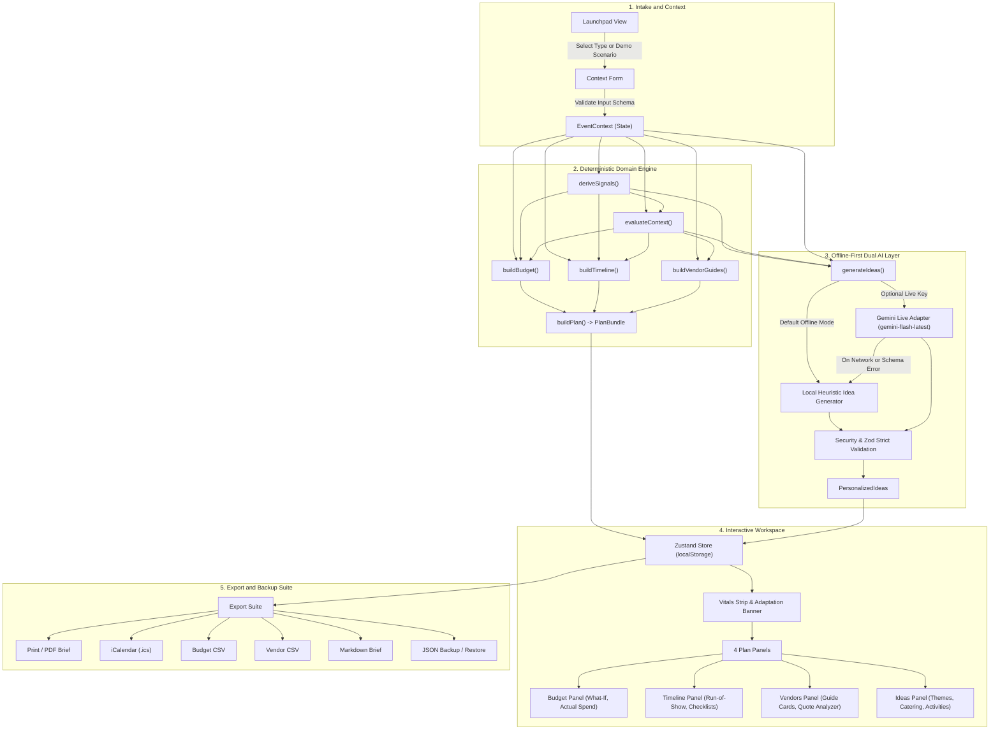

# Gather: Celebration & Event Planner

### Contents

- [1. Chosen Vertical and Persona](#1-chosen-vertical-and-persona)
- [2. Approach and Logic](#2-approach-and-logic)
- [3. How the Solution Works](#3-how-the-solution-works)
- [4. Assumptions Made](#4-assumptions-made)
- [Limitations](#limitations)

Gather is an offline-first, client-only Single Page Application built to coordinate cross-cultural weddings, milestone birthdays, and community events with deterministic financial allocations, backward-scheduled timelines, vendor evaluation checklists, and personalized ideas. Operating entirely inside the user's web browser, Gather couples pure TypeScript calculation engines with an offline-first dual-engine design that requires zero third-party accounts, remote databases, or API keys to function out of the box, while offering an optional live Google Gemini adapter for contextual idea generation.

Live demo: https://akshayjadhav237237-cmd.github.io/gather-event-planner/ (static build served from GitHub Pages; it works offline-first with no API key).

### Quick Start

1. Install project dependencies:
   ```bash
   npm install
   ```
2. Start the local development server:
   ```bash
   npm run dev
   ```
3. Run the automated test suite:
   ```bash
   npm test
   ```
4. Build the production application bundle:
   ```bash
   npm run build
   ```

Gather requires zero API keys, login credentials, or external network connections to run out of the box. All calculations, budget splits, milestone timelines, vendor evaluation guides, run-of-show schedules, and curated ideas execute 100% offline using deterministic domain logic and local seed libraries. Live AI ideation is strictly optional, targeting the Google Gemini model configured via `LIVE_MODEL_CONFIG` in `src/config/constants.ts` (configured as `'gemini-flash-latest'`, defined in that single location). It can be enabled by entering an API key in the application interface, stored transiently in `sessionStorage` with zero persistence.

## 1. Chosen Vertical and Persona

### Flagship Vertical: Cross-Cultural and Multi-Day Wedding Coordination

The flagship vertical addressed by Gather is the coordinator of cross-cultural, interfaith, and multi-day weddings. Families planning celebrations in this category face logistical challenges that conventional single-day wedding tools cannot handle:
- Multi-day milestone coordination spanning distinct ceremonies (such as Haldi, Mehndi, Sangeet, Main Ceremony, and Reception), planned through dedicated milestone tasks (`WEDDING_MULTIDAY_TASKS`) alongside a synchronized minute-by-minute run-of-show schedule for the primary celebration day (`INDIAN_MULTIDAY_WEDDING_TEMPLATE`). Pre-wedding rituals are organized through sequential planning milestones rather than separate day-of run-of-show schedules.
- Strict cultural and dietary requirements (including Jain, vegetarian, Halal, and vegan diets) requiring dedicated catering isolation and vendor compliance checklists.
- Intergenerational guest accommodations, accounting for elderly mobility needs (step-free access, shaded seating, sensory-calm rest lounges and quiet retreat spaces) and multi-age schedules.
- Seasonal weather vulnerabilities, specifically outdoor monsoon rains or extreme summer heat in regional climates, requiring reserve buffers and contingency shelters.
- Multi-currency budgeting, natively supporting Indian Rupee (INR) formatting alongside USD, EUR, and GBP with localized integer arithmetic.

### Shared Domain Engine Across Event Types

Gather uses the same core domain engine for all three celebration types:
1. **Weddings**: Addresses multi-day milestone planning, cultural catering, attire coordination, and venue contracts. Supported sub-formats (5): `western`, `indian_multiday`, `interfaith`, `destination`, and `micro_wedding`.
2. **Birthdays**: Focuses on age-tailored entertainment rotations (toddlers aged 1-3, school kids aged 4-12, teens, and adult milestones), surprise party reveal coordination, and strict allergy alerts (such as peanut or latex allergies). Supported sub-formats (5): `kids_1_3`, `kids_4_12`, `teen`, `adult_milestone`, and `surprise`.
3. **Community Events**: Handles large crowd logistics, municipal liaison permits, volunteer marshalling schedules, sponsor deliverables, and public safety egress. Supported sub-formats (4): `festival`, `fundraiser`, `neighborhood`, and `school_cultural`.

Across all three verticals, Gather defines 14 event sub-formats, 28 budget categories (10 wedding, 8 birthday, 10 community) with 21 bookable vendor evaluation guides (9 wedding, 5 birthday, 7 community), 75 planning milestone task templates, and 121 curated idea seeds. Each event type supplies its own dedicated category sets, baseline planning heuristic splits, per-guest budget floors, and task templates into the pure domain engines, ensuring consistent architectural guarantees across all celebrations.

### Mission Brief Alignment

Gather was engineered in direct alignment with the **[Challenge 5] Celebration & Event Planner** brief:
> *"Create a GenAI-powered planning assistant that helps users organize weddings, birthdays, and community events with budgets, timelines, vendor checklists, and personalized ideas."*

To fulfill this brief comprehensively, Gather implements a 3×4 domain architecture supporting **all three event verticals** across **all four core planning deliverables**:

#### Comprehensive Coverage Across All Three Event Verticals
1. **Weddings (5 Sub-Formats: `western`, `indian_multiday`, `interfaith`, `destination`, `micro_wedding`)**:
   - Multi-day milestone coordination (Haldi, Mehndi, Sangeet, Main Ceremony, Reception) via dedicated milestone tasks and primary-day run-of-show schedules.
   - Strict cultural dietary isolation (Jain, Halal, vegetarian, vegan) with catering verification checks.
   - Intergenerational accommodations (step-free accessibility, shaded seating, quiet lounges).
   - Multi-currency financial planning (USD, EUR, GBP, INR).
2. **Birthdays (5 Sub-Formats: `kids_1_3`, `kids_4_12`, `teen`, `adult_milestone`, `surprise`)**:
   - Age-tiered activity rotations and attention span buffers (toddlers 1–3, kids 4–12, teens, adult milestones).
   - Covert surprise party reveal planning with decoy schedules and hidden guest arrivals.
   - Critical allergy safeguards (latex, peanut, tree nut, gluten).
3. **Community Events (4 Sub-Formats: `festival`, `fundraiser`, `neighborhood`, `school_cultural`)**:
   - Large crowd logistics, wide egress routes, perimeter safety, and first aid stations.
   - Municipal permit workflows and liability insurance compliance.
   - Volunteer marshalling shifts and sponsor banner/booth deliverable tracking.

#### Robust Implementation Across All Four Core Deliverables
1. **Budgets (Deterministic Integer Math & Financial Modeling)**:
   - 28 specialized categories (10 wedding, 8 birthday, 10 community).
   - Largest-remainder integer allocation ensuring category sums plus contingency strictly equal total budget with zero penny-rounding leakage.
   - Dynamic contingency reserves (5%–15%) driven by 18 contextual decision rules.
   - Interactive What-If reallocation simulator, actual spend tracking, and per-guest spending floor feasibility alerts.
2. **Timelines (Backwards Scheduling & Minute-by-Minute Run-of-Show)**:
   - 75 milestone task templates backwards-scheduled from event date with topological dependency ordering.
   - Automated short-notice compression (<21 days) fast-tracking critical path items while skipping non-essential tasks.
   - Synchronized day-of run-of-show schedule with contextual activity durations and buffer adjustments.
3. **Vendor Checklists (Vetted Guides & Quote Comparison Analyzer)**:
   - 21 bookable vendor evaluation guides (9 wedding, 5 birthday, 7 community) with curated interview questions, essential licensing/insurance criteria, and contract watchouts.
   - Vendor quote comparison analyzer computing all-in costs (base quote + fees + taxes) and auditing required safety checks against allocated category budgets without fabricating fake vendors or prices.
4. **Personalized Ideas (Dual-Engine GenAI Ideation)**:
   - 121 curated idea seeds delivering bespoke theme concepts with hex color palettes, catering pairings with dietary safety notes, interactive activities, and custom milestone tasks.
   - Dual-engine GenAI architecture: 100% offline deterministic semantic matching engine + optional live Google Gemini adapter (`gemini-flash-latest`), with zero-delay fallback and strict prompt injection defenses.

## 2. Approach and Logic

### Hybrid Deterministic and Dual-Engine AI Architecture

Gather separates critical planning mathematics from creative ideation:
- **Pure TypeScript Domain Layer (`src/domain/`)**: Pure functions executing without DOM, browser storage, or system clock side-effects. Engines accept `today` as an explicit ISO string parameter (`YYYY-MM-DD`), making all calculations completely reproducible and testable.
- **Offline-First AI Layer (`src/ai/`)**: An offline-first dual-engine design where a local deterministic generator (`src/ai/localIdeaGenerator.ts`) scores and selects ideas from curated banks (121 curated idea seeds in `src/data/ideas/`). When an optional Gemini API key is provided, the live adapter (`src/ai/geminiClient.ts`) requests structured JSON completions, automatically falling back to the local engine on any network, schema, or rate-limit failure.

### Context Signals and Rule Adaptations

Event parameters are derived into signals via `deriveSignals()` in `src/domain/signals.ts`, which are evaluated by 18 deterministic rules defined in `src/data/decisionRulesCore.ts` and `src/data/decisionRulesContext.ts`:

| Rule ID | Trigger | What changes (budget, timeline, vendors, safety, ideas) | Contingency delta |
| :--- | :--- | :--- | :--- |
| `PAST_DATE` | Event date is in the past (`daysUntilEvent < 0`) | Clamps all task due dates to `today` (`task.dueDate = today`) without leaking the calendar date, marks optional tasks as skipped (`skippedInCompression = true`), appends compressed rationale suffix, and emits feasibility alert `DATE_IN_PAST`. | +0% |
| `SHORT_NOTICE` | Planning runway under 21 days (`daysUntilEvent < 21`) | Scales task lead times proportionally, marks optional tasks as skipped (`skippedInCompression = true`), appends compressed rationale suffix, and injects 1 timeline task: `inj-short-notice` ("Fast-track priority vendor agreements and consolidate planning milestones", Foundations phase, 14 days before). | +2% |
| `TIGHT_PER_HEAD` | Per-guest spend below heuristic floor (`perGuestBudget < floorPerGuest`) | Emits budget feasibility alert `UNREALISTIC_PER_HEAD` with guest capacity calculations and spending remedies. | +0% |
| `MICRO_EVENT` | Intimate guest count under 50 (`guestCount < 50`) | Multiplies fixed-cost category weights by 1.15 (`MICRO_EVENT_FIXED_COST_MULTIPLIER`) in `buildBudget` and emits feasibility alert `MICRO_EVENT_FIXED_COSTS`. | +0% |
| `LARGE_CROWD` | Guest count 1000 or more (`guestCount >= 1000`) | Injects 1 timeline task: `inj-large-crowd` ("Plan wide egress routes, perimeter crowd flow, and first aid stations", Details phase, 60 days before). | +2% |
| `YOUNG_KIDS` | Sub-format is `kids_1_3` | Injects 1 timeline task: `inj-young-kids` ("Review child supervision protocols and remove choking hazard decorations", Details phase, 14 days before) and replaces run-of-show with a 4-slot early-day schedule (`buildYoungKidsSchedule`). | +0% |
| `SCHOOL_KIDS` | Sub-format is `kids_4_12` | Injects 1 timeline task: `inj-school-kids` ("Organize structured group games and activity rotation schedules", Details phase, 14 days before). | +0% |
| `OUTDOOR` | Venue setting is `outdoor` or `hybrid` | Injects 1 timeline task: `inj-outdoor` ("Verify weather go/no-go backup plan with venue and rentals", Details phase, 28 days before), appends weather backup verification checks to 7 vendor guides (`wedding:venue`, `wedding:decor_florals`, `wedding:entertainment`, `birthday:venue`, `birthday:decor_balloons`, `community:venue_permits`, `community:production_av`), and injects 1 run-of-show slot: "Weather and ground conditions review" (20 min duration, 10 min buffer, 2 hours prior to arrival). | +3% |
| `HOT_OR_WET_SEASON` | Outdoor or hybrid venue in `summer` or `monsoon` | Injects 1 timeline task: `inj-season` ("Arrange guest cooling amenities or covered inclement weather shelters", Details phase, 21 days before). | +0% |
| `ALLERGY_ALERT` | Flag `nut_allergy`, `latex_allergy`, or `gluten_free` | Injects 1 timeline task: `inj-allergy` ("Conduct allergen intake review with caterer and confirm labeling", Details phase, 21 days before), appends kitchen allergen separation checks to 3 catering vendor guides (`wedding:catering`, `birthday:catering_cake`, `community:food_beverage`), and injects 1 run-of-show slot: "Allergen briefing with catering team and food stations" (15 min duration, 5 min buffer, 20 min before meal). | +0% |
| `DIETARY_CULTURAL` | Flag `vegan`, `vegetarian`, `jain`, or `halal` | Injects 1 timeline task: `inj-dietary` ("Confirm dietary preparation protocols and separated serving utensils", Details phase, 21 days before) and appends dedicated prep area checks to 3 catering vendor guides (`wedding:catering`, `birthday:catering_cake`, `community:food_beverage`). | +0% |
| `ACCESSIBILITY` | Flag `wheelchair_access`, `elderly_guests`, or `sensory_friendly` | Injects 1 timeline task: `inj-accessibility` ("Check step-free route and accessible restroom access", Details phase, 28 days before), appends accessibility and restroom checks to 4 vendor guides (`wedding:venue`, `wedding:transport_stay`, `birthday:venue`, `community:venue_permits`), and adds +10 min buffer to every run-of-show slot. | +0% |
| `MULTI_CEREMONY` | `indian_multiday` sub-format or `multi_ceremony` flag in weddings | Injects 1 timeline task: `inj-multi-ceremony` ("Coordinate transition logistics and ritual staging across multiple ceremonies", Details phase, 60 days before). (Multi-day milestones load via `WEDDING_MULTIDAY_TASKS`). | +0% |
| `SURPRISE_PARTY` | Sub-format is `surprise` | Injects 1 timeline task: `inj-surprise-party` ("Coordinate covert guest arrivals, decoy schedule, and reveal cues", Details phase, 14 days before) and injects 3 run-of-show slots if not present: "Secret guest arrival and coordination briefing" (30 min duration, 10 min buffer), "Guest quiet hiding and staging in position" (15 min duration, 5 min buffer), and "Guest of honor arrival and surprise reveal moment" (15 min duration, 10 min buffer). | +0% |
| `COMMUNITY_PUBLIC_EVENT` | Event type is `community` | Injects 1 timeline task: `inj-community-public` ("Confirm local permits and liability insurance with municipal office", Foundations phase, 90 days before) and injects 1 run-of-show slot: "Site safety inspection and volunteer briefing" (30 min duration, 15 min buffer, 45 min before gates open). | +0% |
| `SPONSORSHIP` | Flag `sponsorship_needed` | Injects 1 timeline task: `inj-sponsorship` ("Finalize sponsor banner placement, announcements, and booth setups", Details phase, 30 days before). | +0% |
| `OPEN_BAR` | Flag `open_bar` with `guestCount >= 50` | Injects 1 timeline task: `inj-open-bar` ("Review beverage service standards and organize safe transport options", Details phase, 28 days before), appends liquor liability and server license checks to 6 vendor guides (`wedding:venue`, `wedding:catering`, `birthday:venue`, `birthday:catering_cake`, `community:venue_permits`, `community:food_beverage`), and injects 1 run-of-show slot: "Bar last-call and service closure" (15 min duration, 5 min buffer, 40 min before close). | +0% |
| `AMPLIFIED_MUSIC_RESIDENTIAL` | Flags `amplified_music` and `residential_venue` | Injects 1 timeline task: `inj-amplified-music` ("Plan sound system orientation and schedule residential volume curfew", Details phase, 14 days before); in run-of-show: truncates activities past 21:30, injects 1 slot: "Amplified music wind-down and acoustic transition" (25 min duration, 0 min buffer) at 21:30, and renames subsequent music activities to "Acoustic background music and guest farewells". | +0% |

### Budget Allocation Methodology

1. **Base Contingency**: Baseline heuristic contingency reserves are assigned by event type (`wedding`: 8%, `birthday`: 7%, `community`: 12%).
2. **Dynamic Clamping**: Triggered decision rules add contingency deltas. The final contingency percentage is clamped strictly between `CONTINGENCY_MIN` (0.05) and `CONTINGENCY_MAX` (0.15) from `src/config/constants.ts`.
3. **Integer Math and Largest-Remainder Rounding**: The allocatable budget (`totalBudget - contingencyAmount`) is distributed across category weights using the largest-remainder method in `src/utils/allocate.ts`. Category allocations and contingency strictly sum to the total budget with zero rounding leakage.
4. **Priority Rebalancing**: Up to 3 user-selected priorities receive a `PRIORITY_WEIGHT_MULTIPLIER` (1.25) boost, proportionally adjusting the remaining categories.

### Timeline Scheduling Methodology

1. **Backwards Planning**: Due dates are calculated backwards from `eventDate` using task template day offsets (`daysBefore`).
2. **Short-Notice Runway Scaling**: When available runway is less than the baseline planning horizon, task offsets are scaled proportionally. If `daysUntilEvent < COMPRESSED_THRESHOLD_DAYS` (21) or if the date has passed, optional tasks are flagged as `skippedInCompression`, allowing users to focus on critical-path milestones.
3. **Topological Dependency Propagation**: Task dependencies are resolved via dependency ordering in `computeTopologicalOrder()` (calculating in-degrees and propagating maximum prerequisite due dates), ensuring dependent task due dates are scheduled on or after their prerequisite due dates (`task.dueDate = max(task.dueDate, maxDepDate)`). Tasks are then sorted by `dueDate` ascending.
4. **Day-of Run-of-Show**: Generates a synchronized minute-by-minute schedule for the primary celebration day with contextual buffers.

### Vendor Evaluation Methodology

Gather avoids fabricating vendor names, addresses, ratings, or prices:
- **Evaluation Guides**: Supplies curated interview questions, essential licensing checks, and contract watchouts mapped to event categories and contextual rules.
- **Quote Comparison**: Evaluates user-entered vendor quotes by computing all-in totals (base quote + service fees and taxes), comparing figures against category budget allocations, and auditing required safety checks.

## 3. How the Solution Works

### End-to-End User Workflow



1. **Launchpad**: The user selects an event vertical (Wedding, Birthday, Community) or selects one of 4 realistic pre-configured scenarios.
2. **Context Form**: The user customizes event date, guest count, total budget, currency, venue setting, season, priority categories, and constraint flags.
3. **Vitals & Adaptation Banner**: Displays per-guest metrics, planning runway, contingency status, and active rule explanations with severity badges.
4. **Four Core Panels**:
   - **Budget Panel**: Category allocations, actual spend tracking, visual progress bars, feasibility alerts, and What-If financial sliders.
   - **Timeline Panel**: Phased milestone task checklists, short-notice compression notices, and day-of run-of-show schedule.
   - **Vendors Panel**: Category evaluation guides, required safety checklists, and quote comparison calculator.
   - **Ideas Panel**: Bespoke theme concepts with color palettes, catering pairings with dietary safety notes, interactive activities, and custom milestones.
5. **Export & Backup**: One-click generation of print briefs, calendar schedules, spreadsheets, plain text notes, and portable JSON backups.

### AI Operation Modes (Dual-Engine GenAI Architecture)

Gather employs an offline-first dual-engine GenAI architecture combining private deterministic local execution with optional live Google Gemini intelligence:

1. **Local Deterministic Heuristic Engine (`local` mode — default)**:
   - **Offline-First & Private**: Operates 100% in-browser with zero external network requests, zero third-party dependencies, and zero data leakage.
   - **Semantic Context Scoring**: Uses pure seeded hashing (`src/ai/seededRandom.ts`) and context matching against 121 curated idea seeds across all 14 sub-formats (`src/data/ideas/`).
   - **Personalized Planning Deliverables**: Selects cohesive event themes with hex color palettes, catering pairings with allergen and dietary guidelines, tailored guest activities, and custom planning tasks matched to the user's specific event signals.
   - **Performance**: Sub-millisecond execution with zero API cost, latency, or rate limits.

2. **Live Google Gemini Adapter (`live` mode — optional)**:
   - **Activation**: Enabled on demand when the user enters a Google Gemini API key, stored strictly in `sessionStorage` (`API_KEY_SESSION_KEY`) with zero persistence.
   - **Model Configuration**: Targets Google Gemini via `https://generativelanguage.googleapis.com/v1beta` using the exact model string `'gemini-flash-latest'` configured in `LIVE_MODEL_CONFIG` in `src/config/constants.ts` (the single centralized location defining the live model ID).
   - **Structured System Prompting**: Sends structured prompts incorporating event parameters, budget tiers, venue settings, season, and active decision rules (`src/ai/promptBuilder.ts`), demanding strict JSON conforming to Zod schemas.
   - **Contextual Creativity**: Generates novel, highly tailored ideas, bespoke menus, interactive activities, and event-specific planning advice conditioned on custom user notes.

3. **Graceful Fallback & Resilient Degradation (`fallback` mode)**:
   - **Zero User Disruption**: If a live Gemini request times out (8000ms timeout), encounters network disconnects, hits rate limits (HTTP 429), or fails strict Zod schema validation, Gather instantly and silently falls back to the local deterministic generator.
   - **Guaranteed Continuity**: The user always receives complete, high-quality personalized ideas without error popups, blank screens, or interrupted planning workflows.
   - **In-Memory LRU Caching**: Successful generations are cached in an in-memory LRU cache (`src/ai/responseCache.ts`, capacity 20) keyed by query hash, preventing unnecessary API roundtrips and preserving user quota.

### Security Measures Implemented

- **Session-Only Secrets**: API keys are saved strictly in `sessionStorage` under `event-planner:api-key`. Keys are never written to `localStorage`, URL parameters, state backups, or git.
- **Input Sanitization**: User notes are filtered through `sanitizeUserText()`, stripping control characters, normalizing unicode (NFKC), and collapsing whitespace.
- **Prompt Injection Defense**: `detectInjection()` scans user input against known jailbreak, role-override, and instruction-escape signatures. Flagged notes are discarded from prompts before inference.
- **Nonce-Delimited Isolation**: User notes sent to the LLM are enclosed within cryptographically randomized XML tags (`<user_notes_${nonce}>`) generated via `crypto.getRandomValues()`.
- **Strict Schema Enforcement**: All AI responses are validated against Zod schemas configured with `.strict()`, rejecting responses containing injected or unexpected keys.
- **Plain Text Rendering**: AI responses are rendered strictly as text nodes in React, preventing HTML, script, or markdown injection.
- **Content Security Policy (CSP) & Referrer Policy**: Delivered via a `<meta>` tag as the first child of `<head>` (`src/config/csp.ts`), with `<meta name="referrer" content="no-referrer">`. Restricts default resources (`default-src 'none'`), scripts (`script-src 'self'`), styles (`style-src 'self'` with zero inline styles), fonts (`font-src 'self'`), images (`img-src 'self' data:`), and connections (only self and Google Gemini via `connect-src 'self' https://generativelanguage.googleapis.com`), while setting `object-src 'none'`, `frame-src 'none'`, `worker-src 'none'`, `media-src 'none'`, `manifest-src 'self'`, `base-uri 'none'`, and `form-action 'none'`. Because GitHub Pages serves static files and does not support custom HTTP response headers, CSP is delivered exclusively via `<meta>` tags; header-only directives such as `frame-ancestors` and `Strict-Transport-Security` (HSTS) cannot be configured from the application bundle.
- **CSV Formula Injection Mitigation**: CSV export cells starting with `=`, `+`, `-`, `@`, `\t`, or `\r` are prefixed with a single quote (`'`), preventing spreadsheet formula execution.
- **JSON Prototype Pollution Protection**: JSON backups are validated with Zod envelope schemas and size bounds (1 MB limit, bounded array lengths) before state restoration.

### Accessibility and Design System

- **WCAG 2.1 AA Guidance**: Visual tokens defined in `src/index.css` are verified through automated test suites (`tests/contrast.test.ts`), maintaining contrast ratios exceeding 4.5:1 for muted text and 7:1 for primary ink against backgrounds.
- **Native Semantic HTML**: All interactive elements utilize semantic `<button>`, `<input>`, `<select>`, `<dialog>`, and `<fieldset>` tags.
- **Focus Visibility**: Custom focus rings (`:focus-visible`) styled via `--color-focus` tokens.
- **Accessible Modals and Live Regions**: Modals utilize the HTML `<dialog>` element with backdrop dismissals and focus restoration. Status notifications and alerts incorporate `role="status"` and `role="alert"`.
- **Accessibility Testing Scope**: Gather was built toward WCAG 2.1 AA guidance using automated token contrast tests and keyboard-interaction tests. Automated visual-regression testing and manual screen-reader testing with assistive technology were not performed.

### Testing and Verification

Gather features an automated Vitest test suite covering unit, integration, and render smoke tests (run `npm test` to execute the complete test suite):
- **Calculation Engines**: Budget allocation invariants, largest-remainder rounding guarantees, backward timeline dependencies, and vendor quote rankings.
- **AI Infrastructure**: Input sanitization, prompt construction, nonce validation, injection detection, response caching, and fallback transitions.
- **Render Smoke Testing**: Full application and all four core panels are verified using `renderToStaticMarkup` across all demo scenarios (`tests/renderSmoke.test.tsx`), asserting zero `NaN`, `undefined`, `[object Object]`, or `Infinity` tokens.

### Export and Backup Suite

Gather supports six client-side export and data portability formats:
1. **Print / PDF Brief**: Formatted printable executive summary with print stylesheets for physical distribution or saving as PDF via the browser print dialog.
2. **iCalendar Schedule (`.ics`)**: Standard RFC 5545 calendar file containing the celebration date and uncompleted milestone tasks for import into Google Calendar, Apple Calendar, or Outlook (excludes completed tasks, tasks skipped during compression, and intra-day run-of-show slots).
3. **Budget CSV**: RFC 4180 spreadsheet export detailing category allocations, planning percentages, actual expenditures, and remaining funds.
4. **Vendor Comparison CSV**: Formatted spreadsheet of entered vendor quotes, all-in costs, deposit balances, and compliance verification statuses.
5. **Plain Markdown Brief (`.md`)**: Clean, formatted plain-text documentation of the complete plan bundle.
6. **JSON State Backup and Restore**: Portable schema-validated snapshot of all event contexts, task completions, expenditures, and quotes.

### Project Structure Tree

```
gather-event-planner/
├── .github/
│   └── workflows/
│       └── ci.yml                 # CI workflow verifying typecheck, lint, test, build, and deploying to GitHub Pages
├── src/
│   ├── ai/                        # Offline-first AI services and LLM adapter
│   │   ├── aiService.ts           # Dual-engine orchestrator with fallback logic
│   │   ├── aiTypes.ts             # AI-specific interfaces and result types
│   │   ├── apiKeyStorage.ts       # Transient sessionStorage API key management
│   │   ├── geminiClient.ts        # Google Gemini Flash API client
│   │   ├── localIdeaGenerator.ts  # Deterministic offline heuristic idea engine
│   │   ├── promptBuilder.ts       # Structured system and user prompt compiler
│   │   ├── responseCache.ts       # In-memory LRU response cache (capacity 20)
│   │   ├── securityGuard.ts       # Sanitization, injection detector, and nonce generator
│   │   └── seededRandom.ts        # Pure deterministic seed hashing
│   ├── components/                # Modular UI components
│   │   ├── adaptations/           # Rule explanation banner and badges
│   │   ├── budget/                # Category breakdown, summary cards, and alerts
│   │   ├── calculators/           # What-If simulator, volunteer, and finance tools
│   │   ├── context/               # Event parameter intake form and priority picker
│   │   ├── ideas/                 # Theme cards, catering recommendations, activities
│   │   ├── launchpad/             # Vertical selection and demo scenario loader
│   │   ├── layout/                # Header, footer, vitals strip, workspace container
│   │   ├── panels/                # Panel controllers (Budget, Timeline, Vendors, Ideas)
│   │   ├── print/                 # Print and PDF brief formatting
│   │   ├── settings/              # API key and reset confirmation dialogs
│   │   ├── shared/                # Section headers, progress bars, alert cards
│   │   ├── timeline/              # Task checklists, compression notice, run-of-show
│   │   ├── ui/                    # Atomic design primitives (Button, Card, Dialog, Tabs)
│   │   └── vendors/               # Evaluation guides, quote form, comparison list
│   ├── config/
│   │   └── constants.ts           # Global configuration constants and boundaries
│   ├── data/                      # Reference datasets and planning heuristics
│   │   ├── ideas/                 # Curated themes, catering ideas, and activities
│   │   ├── tasks/                 # Planning milestone templates per celebration type
│   │   ├── vendors/               # Vendor evaluation guide templates
│   │   ├── budgetPresets.ts       # Baseline category percentages per event type
│   │   ├── categories.ts          # Category definitions per event type
│   │   ├── decisionRulesCore.ts   # Core operational decision rules
│   │   ├── decisionRulesContext.ts# Contextual and cultural decision rules
│   │   ├── demoScenarios.ts       # Pre-configured demonstration event scenarios
│   │   └── perHeadFloors.ts       # Heuristic per-guest spending floors
│   ├── domain/                    # Pure deterministic TypeScript calculation engines
│   │   ├── budgetEngine.ts        # Integer allocation and contingency math
│   │   ├── buildPlan.ts           # Plan bundle compilation coordinator
│   │   ├── communityTools.ts      # Sponsorship and volunteer calculations
│   │   ├── decisionMatrix.ts      # Contextual signal rule evaluation
│   │   ├── ruleIds.ts             # Canonical rule identifier constants
│   │   ├── runOfShow.ts           # Day-of minute-by-minute schedule generator
│   │   ├── signals.ts             # Derived contextual signal calculations
│   │   ├── timelineEngine.ts      # Backwards scheduling and topological sorting
│   │   ├── vendorEngine.ts        # Vendor guide builder and quote comparisons
│   │   └── whatIf.ts              # Budget reallocation simulation
│   ├── export/                    # Data export and backup serialization
│   │   ├── backup.ts              # Schema-validated JSON backup and restore
│   │   ├── backupTypes.ts         # Backup envelope interfaces
│   │   ├── csv.ts                 # RFC 4180 CSV serializer with formula defenses
│   │   ├── ics.ts                 # iCalendar RFC 5545 schedule exporter
│   │   ├── markdown.ts            # Plain-text markdown brief generator
│   │   └── slug.ts                # File naming utilities
│   ├── hooks/                     # Custom React hooks
│   ├── store/
│   │   └── planStore.ts           # Zustand store with safe storage rehydration
│   ├── types/                     # TypeScript definitions and Zod schemas
│   ├── ui/                        # Pure view-model derivations and helpers
│   ├── utils/                     # Pure utilities (currency, date math, allocate)
│   ├── App.tsx                    # Top-level application shell
│   ├── index.css                  # CSS design tokens and base styles
│   └── main.tsx                   # Client entry point
├── tests/                         # Vitest automated test suites
├── index.html                     # HTML entry point with metadata
├── package.json                   # Project metadata, dependencies, and scripts
├── tailwind.config.js             # Tailwind CSS design system configuration
└── vite.config.ts                 # Bundler config setting base path and injecting production CSP
```

### Available Scripts

| Script Name | Command Line | Description |
| :--- | :--- | :--- |
| `dev` | `vite` | Starts the Vite local development server with Hot Module Replacement. |
| `build` | `tsc -b && vite build` | Typechecks the project and builds production assets into `dist/`. |
| `preview` | `vite preview` | Previews the locally built production bundle. |
| `typecheck` | `tsc --noEmit` | Runs strict TypeScript verification without emitting output files. |
| `lint` | `eslint .` | Runs ESLint analysis across all source code and test files. |
| `format` | `prettier --check .` | Verifies code formatting against Prettier conventions. |
| `format:check` | `prettier --check .` | Verifies code formatting against Prettier conventions. |
| `test` | `vitest run` | Executes all Vitest test suites once and outputs summary results. |
| `test:coverage` | `vitest run --coverage` | Executes all Vitest test suites with v8 coverage analysis. |
| `test:watch` | `vitest` | Runs Vitest in interactive watch mode for active development. |

## 4. Assumptions Made

1. **Planning Heuristics**: All percentage distributions, contingency floors, per-guest spending baselines, and milestone horizons are explicit planning heuristics designed to provide structured starting points, not empirical or legal guarantees.
2. **Calendar Dates**: Dates are processed strictly as ISO calendar date strings (`YYYY-MM-DD`). Computations calculate day boundaries using UTC calendar math without local time zone or daylight saving distortions.
3. **Currencies Supported**: The system natively supports Indian Rupee (INR), US Dollar (USD), Euro (EUR), and British Pound (GBP). Financial values are treated as non-negative integers in major currency units.
4. **Generic Compliance Guidance**: Safety, liability, and vendor licensing guidance is generic (such as verifying local permits and requiring certificates of insurance) rather than citing specific statutory codes or jurisdiction-specific regulatory bodies.
5. **Zero Committed Secrets & Local Storage**: The application operates as a client-side Single Page Application. API keys reside transiently in `sessionStorage` (`API_KEY_SESSION_KEY`) and are never written to permanent storage, URL parameters, or backups. All user plans, expenditures, and checklist progress are persisted exclusively to browser `localStorage` (`STORAGE_KEY`) on the user's local device, with no remote database, user accounts, or proprietary backend synchronization.
6. **Static Hosting Architecture**: The live deployment hosted on GitHub Pages is a purely static bundle with zero server components, serverless functions, or backend proxies.
7. **Fictional Demonstration Scenarios**: The four pre-configured scenarios provided on the launchpad are illustrative models created to demonstrate application capabilities across diverse constraint sets.
8. **AI Data Flow and Privacy Boundaries**: When live AI ideation is enabled, Gather sends strictly the following fields to Google Gemini in `buildUserPrompt()`: `eventType`, `subFormat`, `guestCount`, `currency`, `totalBudget`, per-guest `budgetTier`, venue `setting`, `season`, `daysUntilEvent`, active `flags`, active `decision.adaptations` (rule IDs and explanations), sanitized `userNotes` enclosed in cryptographically random XML nonce tags (`<user_notes_${nonce}>`) if present, and optional `section` focus. The calendar event date is not sent directly; only the calculated integer days until the event are transmitted. Sensitive data fields including event `title`, `vendorQuotes` (vendor names, quotes, deposit balances), `actualSpend` (expenditures per category), and task progress (`taskCompletion`) are **never transmitted** to the model. The user-provided API key is transmitted strictly via the HTTP `x-goog-api-key` header directly to Google and is never included in URLs, request bodies, or log outputs.

## Evaluation focus map

| Evaluation Criterion | Implementation Details | Source Verification |
| :--- | :--- | :--- |
| **Code Quality**<br>*(High Impact — Structure, readability, maintainability)* | **Structure & Purity**: Pure, deterministic TypeScript calculation engines in `src/domain/` with zero React/DOM imports; separate AI orchestration in `src/ai/`; pure serializers in `src/export/`.<br>**Readability & Strict Typing**: Zero `any`, zero `@ts-ignore`, zero `@ts-expect-error`, zero `eslint-disable`. Strongly typed models and Zod schemas across domain boundaries in `src/types/`.<br>**Maintainability**: Strict 220-line maximum file length enforced across all 70+ source and test files; centralized single-source configuration in `src/config/constants.ts`. | `src/domain/`, `src/types/`, `src/config/constants.ts`, `tsconfig.json` |
| **Security**<br>*(High Impact — Safe and responsible implementation)* | **Zero Committed Secrets**: API keys stored exclusively in `sessionStorage` (`API_KEY_SESSION_KEY`), never written to `localStorage`, URL parameters, state backups, logs, or git.<br>**Prompt Injection Defense**: Multi-tier defenses in `src/ai/securityGuard.ts` — regex detection for override/jailbreak patterns (`detectInjection()`), unicode normalization and control character stripping (`sanitizeUserText()`), and cryptographically random XML nonces (`<user_notes_${nonce}>`) via `crypto.getRandomValues()`.<br>**Strict Schema Enforcement**: All AI outputs validated against Zod `.strict()` schemas, rejecting unknown or malicious keys.<br>**Safe AI Rendering**: Rendered strictly as escaped plain text React nodes (zero `dangerouslySetInnerHTML`).<br>**Browser & Data Defenses**: Strict `<meta>` Content Security Policy (`default-src 'none'`, `script-src 'self'`, `connect-src 'self' https://generativelanguage.googleapis.com`), RFC 4180 CSV formula injection mitigation (escaping cells starting with `=,+,-,@,\t,\r`), and JSON backup prototype pollution protection (`__proto__`, `constructor`, `prototype` rejection with 1 MB limit). | `src/ai/securityGuard.ts`, `src/export/csv.ts`, `src/export/backup.ts`, `src/config/csp.ts` |
| **Efficiency**<br>*(High Impact — Optimal use of resources)* | **Zero Heavy UI Libraries**: Handcrafted accessible components using native HTML controls and Tailwind CSS design tokens; zero runtime CSS-in-JS overhead or heavy bundle bloat.<br>**Sub-Millisecond Engine Calculations**: Pure in-memory algorithms for integer budget allocation (largest-remainder), backwards timeline scheduling, and signal evaluation execute in <1ms without blocking the UI thread.<br>**Offline-First Resource Economy**: 100% of planning functionality operates client-side with zero network bandwidth consumption out of the box.<br>**In-Memory LRU Response Cache**: Capacity-20 query-hash cache (`src/ai/responseCache.ts`) prevents redundant LLM calls and conserves user API quota.<br>**Lean Production Bundle**: Optimized Vite build compiling to ~72 KB gzipped JavaScript + CSS with instant sub-second initial load. | `src/domain/budgetEngine.ts`, `src/domain/timelineEngine.ts`, `src/ai/responseCache.ts`, `vite.config.ts` |
| **Testing**<br>*(Medium Impact — Validation of functionality)* | **Automated Vitest Test Suite**: 596 automated unit, integration, accessibility, and render smoke tests across 65 test suites (`npm test`).<br>**Calculation Invariants**: Tests verify budget largest-remainder rounding guarantees (category sums + contingency === totalBudget), topological dependency ordering, short-notice compression, and multi-quote financial calculations.<br>**AI Infrastructure Tests**: Verifies input sanitization, prompt compiler generation, nonce isolation, injection detection, LRU cache eviction, and seamless fallback degradation.<br>**Render Smoke Validation**: Full application and all four core panels verified via `renderToStaticMarkup` across all demo scenarios (`tests/renderSmoke.test.tsx`), asserting zero `NaN`, `undefined`, `[object Object]`, or `Infinity` tokens.<br>**SEO & Machine-Readable Audits**: Tests verifying CSP meta tags, canonical links, OpenGraph metadata, JSON-LD WebApplication schema, `robots.txt`, `sitemap.xml`, and `llms.txt` discoverability assets (`tests/seo.test.ts`). | `tests/`, `tests/renderSmoke.test.tsx`, `tests/seo.test.ts` |
| **Accessibility**<br>*(Medium Impact — Inclusive and usable design)* | **WCAG 2.1 AA Color Contrast**: All design tokens verified through automated unit tests (`tests/contrast.test.ts`), maintaining >4.5:1 for muted text and >7:1 for primary ink against backgrounds.<br>**Native Semantic Controls**: Interactive elements utilize standard `<button>`, `<dialog>`, `<fieldset>`, `<input>`, and `<select>` tags with full keyboard navigation and bound labels.<br>**Visible Focus Indicators**: High-visibility `:focus-visible` outline rings styled with dedicated `--color-focus` tokens.<br>**Accessible Modals & Live Regions**: Native `<dialog>` implementation with keyboard trap and focus restoration; dynamic announcements backed by `role="status"` and `role="alert"`.<br>**Testing Scope Disclosure**: Transparent documentation of accessibility validation scope (token contrast and keyboard interaction tests verified; visual-regression and screen-reader hardware testing omitted). | `tests/contrast.test.ts`, `src/components/ui/`, `src/index.css` |
| **Problem Statement Alignment**<br>*(Low Impact — Relevance to the stated problem)* | **Direct Realization of [Challenge 5] Celebration & Event Planner**: Delivers an intelligent, GenAI-powered planning assistant covering **all three celebration verticals** (Weddings, Birthdays, Community Events across 14 sub-formats) and **all four core planning deliverables**:<br>1. **Budgets**: Integer allocation via largest-remainder math, dynamic contingency reserves (5%–15%), What-If simulation, and per-guest spending floors.<br>2. **Timelines**: Backwards-scheduled milestones from event date, topological dependency ordering, short-notice compression (<21 days), and day-of run-of-show schedules.<br>3. **Vendor Checklists**: 21 bookable vendor evaluation guides with curated interview questions, safety/licensing criteria, and quote comparison analyzer.<br>4. **Personalized Ideas**: 121 curated idea seeds with dual-engine GenAI (offline deterministic semantic engine + optional live Google Gemini adapter). | `src/domain/buildPlan.ts`, `src/data/`, `src/ai/` |

## Limitations

1. **Testing Scope**: No automated visual-regression testing and no screen-reader testing were performed. Accessibility was built toward WCAG 2.1 AA and checked with automated contrast tests and keyboard-interaction tests only.
2. **Planning Numbers**: Planning numbers are heuristics. All percentage splits, spending baselines, milestone horizons, and contingency reserves are heuristic planning guidelines intended as starting points, not empirical facts or legal guarantees.
3. **Storage Architecture**: Single-device local storage only. Plans are persisted exclusively to browser `localStorage` on the host device; transferring plans between devices or browsers requires manual JSON export and restore.
4. **Live AI Availability**: Live AI ideation requires an active internet connection and a user-provided Google Gemini API key. When offline or without an API key, the system uses the deterministic local heuristic generator.
5. **Print Engine Dependency**: Physical and PDF brief formatting relies on the native print engine of the host web browser, which may introduce minor layout differences across operating systems and print drivers.
6. **Search Indexing & Robots Configuration**: Gather is a client-rendered Single Page Application. Static fallback content is provided in `index.html` for basic crawler discovery. While `robots.txt` and `sitemap.xml` are served under the project path (`/gather-event-planner/`), web crawlers typically look for `robots.txt` at the domain root; on subpath hosting like GitHub Pages project sites, search engines may require manual sitemap submission in search console tooling.
7. **Zod Advisory GHSA-mrhx-c7xc-m3w5**: The runtime dependency `zod` (`^3.23.8` in package.json, lockfile `3.25.76`) reports advisory GHSA-mrhx-c7xc-m3w5 affecting versions `<4.6.6`, which has not been upgraded because the patched release requires migrating to Zod 4 with breaking API changes; staying on Zod 3 preserves zero-breaking-change runtime stability.
